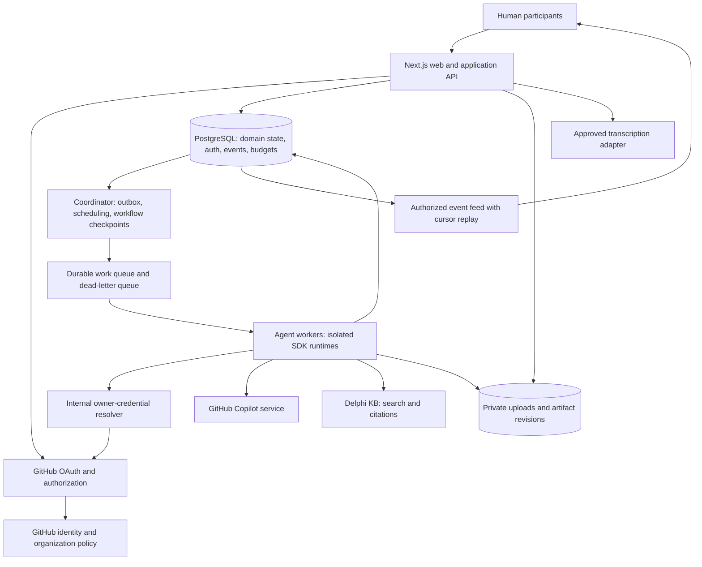
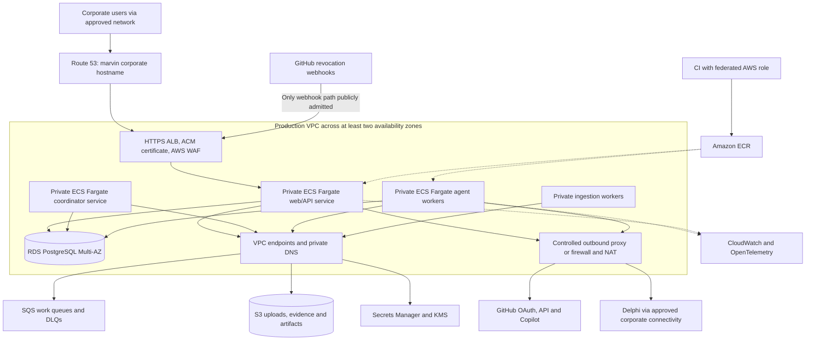
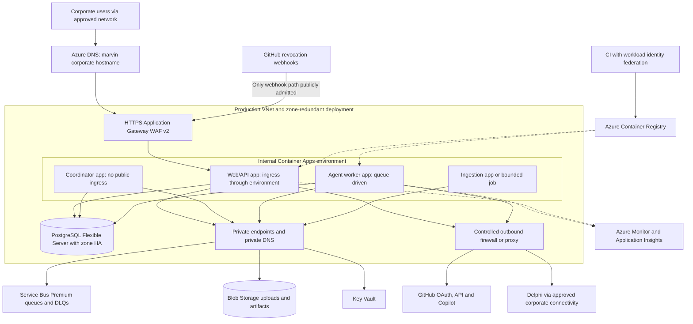

# Marvin Council — proposed production architecture

**Date:** 27 October 2026  
**Status:** Proposal for review; no cloud resources are provisioned by this document.  
**Scope:** An internal application for product discovery and software specification councils, using GitHub Copilot, Delphi KB, and human approval.

## 1. Recommendation

Use **managed containers, managed PostgreSQL, object storage, and a durable queue**. Separate the interactive Next.js application from the workers that run councils. Keep the application design the same on both clouds.

- **AWS proposal:** ECS on Fargate, Application Load Balancer with WAF, RDS PostgreSQL Multi-AZ, SQS, and S3.
- **Azure proposal:** Azure Container Apps, Application Gateway WAF, Azure Database for PostgreSQL Flexible Server with zone-redundant HA, Service Bus Premium, and Blob Storage.

Choose the organization's established cloud landing zone, especially the one with the simplest approved network path to Delphi and the strongest operational ownership. GitHub Copilot does not, by itself, make Azure a better hosting choice. If the organization already operates Azure networking, identity, and monitoring, use the Azure proposal; if those capabilities are established in AWS, use AWS. Building both deployments initially would increase maintenance without improving the product.

Do not introduce Kubernetes, a second vector database, or a second workflow platform for the first production release. Revisit these only when measured needs justify them. Delphi remains the knowledge retrieval service; Copilot remains the model provider. Amazon Bedrock and Azure model hosting are not required for the agreed model path.

## 2. What exists and what is proposed

| Area | Current repository | Production requirement |
| --- | --- | --- |
| Web experience | Next.js mock councils, marketplace, GROW setup, chat and exports | Preserve the UI; replace browser-only domain storage with authenticated APIs |
| Authentication | GitHub App OAuth, PostgreSQL auth schema, encrypted tokens, organization checks, refresh, logout and revocation webhook | Configure and validate a corporate GitHub App, database, secrets and network |
| Copilot | Local CLI diagnostic and authenticated single-request SDK check | Durable parallel agent execution under the designated session owner |
| State and documents | Council data in localStorage; no shared document backend | PostgreSQL records plus private object storage, revisions and authorization |
| Orchestration | Not implemented | Checkpointed workflow, queue dispatch, cancellation, retries and budget accounting |
| Integrations | Delphi, transcription and Figma previews not connected | Delphi API adapter and an approved speech adapter; confirm preview source |
| Infrastructure | No deployment/IaC definition found during this review | Container images, infrastructure code, CI/CD, monitoring and recovery runbooks |

The OAuth implementation is a foundation, not a complete production council backend. In particular, its diagnostic endpoint uses the currently signed-in user's token. It does not yet resolve a persisted council owner's authority for unattended jobs. See [production OAuth setup](docs/production-oauth.md) and the [product plan](docs/product-plan.md).

## 3. Planning assumptions

These are initial sizing and operational proposals, not confirmed demand or service guarantees:

- One internal organization, with separate development, staging and production environments.
- One primary region, with availability-zone resilience. Region selection follows approved data residency and Delphi proximity; no country is inferred from the user's timezone.
- Initial load-test envelope: **five simultaneously active councils**, four specialists per council plus a moderator, and up to ten human participants per council. Moderator synthesis normally follows specialist work; admission control also caps aggregate in-flight model calls.
- One hour of cumulative active session processing, with explicitly authorized extensions. Recommended interpretation: count the union of active run intervals once per council, not four times for four parallel agents. This clock interpretation still needs product approval.
- Token usage is summed across every specialist, moderator, synthesis and billable retry. Waiting for humans consumes neither worker capacity nor active-processing time.
- Proposed application availability objective: 99.9% monthly for accepting/retrieving council work. Track model-provider and Delphi availability separately; the application should remain readable during their outages.
- Proposed disaster-recovery objectives: RPO at most 15 minutes and RTO at most four hours. These are acceptance targets requiring restore drills, not promises from selecting managed services.

## 4. Shared application architecture



### Workload boundaries

| Workload | Responsibilities | Deployment boundary |
| --- | --- | --- |
| Web/API | Next.js, GitHub OAuth, council CRUD, permissions, contributions, approvals, uploads/downloads and event delivery | At least two stateless replicas; no long-running council loops |
| Coordinator | Durable workflow progression, outbox dispatch, due work, stale-lease recovery and cancellation | Two replicas using database leases; each scheduling decision has one fenced owner |
| Agent worker | One bounded agent step per execution slot, isolated Copilot runtime, assigned context and Delphi access | Independent scaling; no public ingress; start with one model operation per worker replica |
| Ingestion worker | File validation, malware scanning, text extraction and context preparation | Separate sandboxed workload with stricter permissions; add when real uploads are enabled |
| Internal credential resolver | Confirm execution owner, current job authority, organization access and token freshness | Initially an internal API capability; accessible only to authenticated worker identities |

Use **LangGraph for TypeScript** as the proposed council state machine with a PostgreSQL checkpointer. Evaluate it against resume, cancellation and parallelism tests before committing to its checkpoint schema. Add LangChain only for specific useful adapters. LangGraph persistence does not replace the application database, queue, budget ledger or authorization layer. [LangGraph persistence documentation](https://docs.langchain.com/oss/javascript/langgraph/persistence)

### Durable execution and parallelism

Persist the session, immutable agent/trait/skill versions, context assignments, owner ID, work items, artifact revisions and approval records. Put a work request and its outbox event in the same database transaction; dispatch the event after commit. Queue messages contain identifiers and version numbers, not credentials or document contents.

Workers claim a work item using a lease and fencing/version token. Database uniqueness constraints deduplicate contributions and completed steps. Both queue deliveries and external calls can repeat: do not promise exactly-once model invocation. A crash after the provider accepted a request but before completion was persisted is an **ambiguous attempt**; retain its usage reservation and reconcile available provider evidence before retrying. Pause for review when spending cannot safely be established.

Make work items bounded steps, not entire hour-long council meetings. Initially target roughly 30–120 seconds per step, subject to SDK capability testing, with explicit call deadlines. Checkpoint after each durable transition. Human questions move the session to `waiting_for_input`, release workers, and resume the same session when an authorized answer arrives.

Give each specialist a separate runtime context and namespace. Retrieve only that agent's assigned documents and permitted Delphi evidence. Human access to all council documents is checked separately. Model/tool output and imported Markdown are untrusted inputs; render approved UI components and allowlist tools rather than executing generated HTML or uploaded instructions as code.

### API and event delivery

Use versioned REST APIs for councils, sessions, messages, work requests and artifact revisions. Starting work returns `202 Accepted` plus a run identifier. Use idempotency keys for start/resume/contribution operations and optimistic version checks for revisions and approvals.

Use authenticated SSE for server-to-browser updates, with HTTPS POST for contributions. Persist ordered event IDs in PostgreSQL and support cursor replay after reconnection; the connection is not authoritative session state. Batch token deltas and store meaningful events rather than writing every token individually. Start with short cursor polling as the fallback; add a shared fan-out cache only if measured event volume warrants it.

Send heartbeats, disable response buffering on the event path, and test all ingress layers. Periodically reconnect streams, initially at around two minutes, so session expiry and infrastructure timeouts are handled predictably. Reauthorize each reconnect and close streams when council access is revoked. A disconnected browser must not cancel or restart the council itself.

## 5. Proposal A — AWS

### Infrastructure diagram



The endpoint node denotes access to regional managed services; SQS, S3 and Secrets Manager are not deployed inside customer subnets. Queue consumption follows the shared application diagram.

### Service choices

| Concern | AWS proposal | Reason and configuration |
| --- | --- | --- |
| Compute | ECS Fargate services | Runs Node and SDK child processes; web, coordinator and workers deploy independently. Use on-demand capacity for active production work. |
| Edge | ALB, ACM and AWS WAF | One HTTPS application origin; route to private tasks. Restrict ordinary routes to corporate access and admit only the validated GitHub webhook path separately. |
| Database | RDS PostgreSQL Multi-AZ instance deployment | Auth, council state, checkpoints, durable events and budgets; private subnets, encryption, TLS and automated backups. |
| Work delivery | SQS Standard queues with DLQs | Separate agent and ingestion queues. Assume duplicate/out-of-order delivery and enforce application ordering in PostgreSQL. |
| Documents | Private S3 buckets | Separate quarantine and accepted artifacts; versioning, encryption, lifecycle policies and tightly scoped access. |
| Secrets | Secrets Manager plus KMS | Store GitHub app secrets, Delphi credentials, database credentials and the application encryption key. |
| Images and delivery | ECR plus the organization's CI with OIDC federation | Build once, scan, sign/attest and promote an immutable image digest. |
| Monitoring | CloudWatch plus OpenTelemetry | Infrastructure, application, workflow and provider telemetry with content redaction. |
| Maintenance | EventBridge Scheduler triggering a bounded ECS maintenance task | Run auth cleanup, retention and reconciliation; jobs must be idempotent. |
| Speech | Amazon Transcribe adapter, if approved | Separate transcription permission and metering; confirm language, network and retention requirements before selection. |

ECS Fargate supports ALB integration. An RDS Multi-AZ instance provides a synchronous standby for failover; that standby is not an additional read-serving database. [ECS load balancing](https://docs.aws.amazon.com/AmazonECS/latest/developerguide/service-load-balancing.html), [RDS Multi-AZ behavior](https://docs.aws.amazon.com/AmazonRDS/latest/UserGuide/Concepts.MultiAZSingleStandby.html)

### Networking and resilience

- Spread web/coordinator tasks and database primary/standby across availability zones. Configure database reconnect/retry behavior and validate application recovery after failover.
- Keep tasks and PostgreSQL private. Use an S3 gateway endpoint and appropriate interface endpoints for SQS, Secrets Manager and container/logging dependencies. Account for their recurring cost.
- GitHub and Copilot still require approved outbound connectivity. A NAT gateway provides address translation, not destination filtering: use the organization's egress proxy/firewall where allowlisting is required. Preserve corporate CA validation.
- Connect to Delphi through existing Direct Connect/VPN/private routing if it is internal. Do not assume Delphi is publicly reachable or that a cloud private endpoint makes external SaaS traffic private.
- Make egress resilient across zones rather than creating a single-zone NAT dependency. Prefer established shared networking where appropriate.
- Extend SQS visibility while a bounded step is running; delete the message only after the durable result is committed. If the lease is lost, fence off further writes and stop the attempt. Visibility does not eliminate duplicate delivery. [SQS visibility and failure handling](https://docs.aws.amazon.com/AWSSimpleQueueService/latest/SQSDeveloperGuide/sqs-visibility-timeout.html)
- Drain workers during releases and handle termination by checkpointing or marking an attempt interrupted. Do not depend on being allowed to finish an hour of work during shutdown.

Configure ALB idle timeout and application stream heartbeats together. The documented default idle timeout is 60 seconds, so a silent long-lived stream needs explicit handling. [ALB attributes](https://docs.aws.amazon.com/elasticloadbalancing/latest/application/application-load-balancers.html)

**AWS tradeoff:** Fargate and SQS provide a straightforward worker platform. The fixed production floor includes Multi-AZ PostgreSQL, ALB/WAF, private endpoints and resilient egress, even when few people use the application. Prefer this option when the organization already operates these controls and can reuse approved networking.

## 6. Proposal B — Azure

### Infrastructure diagram



The web app must be reachable from Application Gateway through the environment's private address. In Container Apps terminology this can require **external app ingress within an internal environment**; selecting app-level internal ingress alone can make it unreachable from the gateway. Workers have no ingress. [Container Apps ingress semantics](https://learn.microsoft.com/en-us/azure/container-apps/ingress-overview)

### Service choices

| Concern | Azure proposal | Reason and configuration |
| --- | --- | --- |
| Compute | Azure Container Apps in a workload profiles environment | Separate web, coordinator and agent-worker apps; explicit min/max replicas and resource limits. |
| Edge | Application Gateway WAF v2 | Regional HTTPS entry point into an internal Container Apps environment; preserve the intended application host and OAuth origin. |
| Database | Azure Database for PostgreSQL Flexible Server, General Purpose, zone-redundant HA | Private network access, encrypted storage, TLS, backups, council state and checkpoints. Verify regional HA availability before provisioning. |
| Work delivery | Service Bus Premium | Private endpoints, durable queues, DLQs and separate sender/receiver permissions. |
| Documents | Blob Storage | Private containers, quarantine, versioning and lifecycle rules; zone redundancy where supported and approved. |
| Secrets | Azure Key Vault | App secrets and the application's encryption key; managed identity for secret retrieval. |
| Images and delivery | Azure Container Registry plus CI workload identity federation | Immutable image promotion without long-lived deployment credentials. |
| Monitoring | Azure Monitor, Application Insights and OpenTelemetry | Correlated HTTP, worker, model and workflow diagnostics. |
| Maintenance | Scheduled Container Apps Jobs | Auth cleanup, retention and reconciliation; these are bounded jobs rather than live sessions. |
| Speech | Azure AI Speech adapter, if approved | Separate service from Copilot; validate dictated input, languages, privacy and network access. |

Microsoft documents Application Gateway WAF in front of an internal Container Apps environment. Configure environment zone redundancy and minimum replicas explicitly, rather than assuming that two processes alone imply zone resilience. [Gateway pattern](https://learn.microsoft.com/en-us/azure/container-apps/waf-app-gateway), [Container Apps reliability](https://learn.microsoft.com/en-us/azure/reliability/reliability-container-apps)

### Networking and resilience

- Use a zone-redundant Container Apps environment, with at least two web and two coordinator replicas. Keep baseline worker capacity warm for interactive sessions.
- Use private endpoints for Service Bus, Blob Storage, Key Vault and the registry where supported by the selected tiers; configure private DNS. Choose and validate a supported private networking mode for PostgreSQL at provisioning time.
- Service Bus **Premium** is deliberate: its private endpoint capability is part of this proposal. Downgrading to Standard changes the network architecture, not merely the bill. [Service Bus private access](https://learn.microsoft.com/en-us/azure/service-bus-messaging/private-link-service)
- Connect to internal Delphi through ExpressRoute/VPN or established private routing. Use approved egress for GitHub/Copilot; managed identities do not replace the owner's GitHub credentials.
- Scale workers using Service Bus backlog plus observed active work. Do not immediately scale to zero because messages have been locked and the visible queue is empty. Use a warm minimum, bounded steps, graceful shutdown and durable recovery. KEDA scaling is available, but it does not make application work interruption-proof. [Container Apps scaling](https://learn.microsoft.com/en-us/azure/container-apps/scale-app)
- Receive with Peek-Lock, renew locks during work, and complete messages after committing results. Lock loss and settlement failures must be safe to recover through the same idempotency/lease mechanism. [Service Bus lock and settlement behavior](https://learn.microsoft.com/en-us/azure/service-bus-messaging/message-transfers-locks-settlement)
- Run councils independently of HTTP request lifetime. Container Apps documents HTTP request timeouts and stream-capable ingress; verify the selected ingress mode and gateway settings end to end rather than treating a live socket as a durable worker. [Container Apps ingress](https://learn.microsoft.com/en-us/azure/container-apps/ingress-overview)

Use a General Purpose or Memory Optimized PostgreSQL tier for HA; Burstable does not support HA. Confirm that the selected region can provision zone-redundant HA. [PostgreSQL HA configuration](https://learn.microsoft.com/en-us/azure/postgresql/high-availability/how-to-configure-high-availability)

**Azure tradeoff:** Container Apps provides revision deployment and queue-based scaling without operating AKS. The private production baseline has meaningful fixed costs, especially Application Gateway, Service Bus Premium, PostgreSQL HA and corporate egress. This is attractive when the organization already has an Azure landing zone, ExpressRoute, Key Vault and Azure Monitor operations.

## 7. Session lifecycle and budget enforcement

```mermaid
sequenceDiagram
    actor Human
    participant API as Application API
    participant DB as PostgreSQL
    participant Coord as Coordinator
    participant Queue as Durable queue
    participant Worker as Agent workers
    participant Model as GitHub Copilot

    Human->>API: Start or resume session
    API->>DB: Check permissions, owner consent and revision
    API->>DB: Commit run and outbox event atomically
    API-->>Human: Accepted with run ID
    Coord->>DB: Claim due work using lease and fencing token
    Coord->>Queue: Publish bounded specialist steps
    par Architect perspective
        Queue->>Worker: Architect step ID
        Worker->>DB: Reserve shared budget and load assigned context
        Worker->>Model: Request under authorized owner
    and Product perspective
        Queue->>Worker: Product step ID
        Worker->>DB: Reserve from the same budget ledger
        Worker->>Model: Separate agent context, same authorized owner
    end
    Model-->>Worker: Results and available usage
    Worker->>DB: Commit result, reconcile usage, append event
    Worker->>Queue: Acknowledge committed step
    Coord->>DB: Checkpoint; synthesize or wait for a human
    API-->>Human: Authorized event stream or cursor replay
    Human->>API: Answer question or approve exact artifact revision
    API->>DB: Store contribution; invalidate superseded approvals
```

The central budget ledger must atomically reserve allowance **before** parallel calls start, include the moderator, and retain spent/reserved amounts after retries and resume. Reserve a synthesis allowance within the total limit. Unknown usage is not zero. Record token usage separately from GitHub billing units, cloud spend and speech charges.

A strict token ceiling requires enforceable request bounds and sufficient SDK usage/control hooks. Neither a queue nor a cloud budget alarm can guarantee zero overshoot for in-flight model work. Validate SDK behavior, including internal tool loops, before advertising a hard cap. Until then, use conservative reservations, bounded turns, early stopping and an explicit overshoot policy.

Persist the active clock, cancellation flag, authorized extensions and worker heartbeats. On process failure, conservatively account for an uncertain active interval rather than resetting time. A pause/cancel request prevents new work and signals running workers to stop; any residual provider usage still belongs to that session.

## 8. Identity, secrets and data protection

**Three identities remain separate:** the human caller, the designated council execution owner, and the cloud workload identity. A participant joining the council does not authorize using their Copilot account or charging them.

Persist the owner assignment and explicit authorization for unattended execution. The internal credential resolver must check the work item's lease, session, owner, current authorization and organization access before yielding a token to a worker. Refresh under the existing database concurrency control. Never put tokens in queues, logs, artifacts or browser storage. Revocation must stop admission of new work and trigger distributed cancellation; the current local diagnostic's process-only controls are not sufficient for that lifecycle.

For the initial deployment, keep the existing AES-GCM application encryption key in Secrets Manager or Key Vault. Storage encryption with KMS/Key Vault does not automatically replace that application key. Give only the auth/credential capability access to it; a future envelope-encryption/key-version migration requires application changes. Initially use a dedicated PostgreSQL runtime role with its credential in the secret store. IAM/Entra database authentication requires additional token renewal and connection-pool integration; it is not enabled by the current code.

Use private storage and authorize access by council, document and revision. Where browsers can reach object storage through corporate routing, use short-lived, object-scoped upload/download URLs. Otherwise proxy bounded transfers through the API. Do not enable public buckets/containers to bypass private endpoint reachability. Validate size/type, scan quarantined uploads, and isolate parsers before making content available to agents.

Delphi's bearer token alone does not prove that every participant may see every retrieved source. Confirm its permission model and citation contract. Admit a document into shared council context only when all intended human participants are authorized to receive it; agent assignment is a separate restriction. Preserve source identifiers, retrieval time and content/version references. Do not clone the entire knowledge base into Marvin.

Normal UI/API routes may be restricted to corporate egress/VPN. The GitHub OAuth callback is a **browser redirect**, so users need access to it. Revocation webhooks are **server-to-server**, so expose that exact HTTPS path to GitHub with signature validation and rate limits even if ordinary routes are network-restricted. Use the same fixed `APP_ORIGIN` throughout.

Retain GitHub OAuth for application identity. Existing corporate network access controls can complement it; introducing another cloud login layer must not silently substitute an Entra or AWS identity for the Copilot execution owner. Current code targets GitHub.com/api.github.com; validate corporate host compatibility before deployment.

## 9. Starting capacity and scaling

These are load-test starting points, not benchmark results or committed cloud SKUs:

| Component | Initial allocation | Scaling signal and guardrail |
| --- | --- | --- |
| Web/API | 2 replicas, about 1 vCPU / 2 GiB each | Latency, concurrent connections and CPU; initially cap at 4 replicas |
| Coordinator | 2 replicas, about 0.5–1 vCPU / 1–2 GiB each | Scheduling lag; database leases prevent duplicate decisions |
| Agent worker | 2 warm replicas, about 2 vCPU / 4 GiB each; initially up to 20 | Backlog age and active leases; one SDK operation per replica initially |
| Ingestion | 0–2 independently scaled workers | Quarantine backlog, parser memory and document size |
| PostgreSQL | General-purpose HA, roughly 2–4 vCPU / 8–16 GiB as a starting range | Connections, transaction latency, IOPS, checkpoint/event growth |

Load-test the exact Linux image and SDK runtime. Do not choose ARM images or reduce memory based only on frontend benchmarks. Adjust allocations to each platform's supported profiles.

The worker maximum is not permission to exceed provider rate limits or the session budget. Apply shared per-owner, per-session and organization-wide admission limits. Some councils will queue when these limits are reached. Set database pool sizes across **all** replicas: the current pool allows ten connections per process, which cannot be copied uncritically to every worker at high scale. Introduce connection pooling/proxying only after checking compatibility with transactions and workflow checkpoints.

## 10. Recovery, delivery and operations

| Failure | Required behavior |
| --- | --- |
| Browser disconnect | Resume event feed by cursor; do not restart model work |
| Worker crash/scale-in | Expire lease, fence stale writes, recover from checkpoint; treat uncertain provider calls explicitly |
| Database unavailable | Stop admitting new model calls; fail closed on authorization and spending; retain queue messages |
| Copilot or Delphi unavailable | Bounded retries with jitter; pause affected steps and preserve readable council history |
| Owner revokes access | Stop new work, cancel running work, require renewed authorization; never borrow another participant's token |
| Poison message | Move to DLQ, alert, inspect and deliberately replay; no indefinite automatic spending |
| Zone loss | Recover replicas and database connections; retry only idempotent operations |
| Region loss | Recreate infrastructure and restore state/artifacts/keys in an approved recovery region |

Use database point-in-time recovery, versioned objects, and tested restoration of the encryption key. Cross-region backups/replication are proposed only where data-residency policy permits them. Backups and object copies are asynchronous and may not form one consistent instant: reconcile artifact references and orphaned uploads after restoration. Rebuild queued work from durable database records/outbox entries; do not depend on copying ephemeral worker state or queue contents. HA is not a backup.

Run quarterly recovery drills against the proposed RPO/RTO. Revalidate owner authorization before resuming restored work, because restored credentials and approval records may predate a revocation or later revision.

Define infrastructure in **Terraform**, with separate cloud modules and isolated state per environment. Use existing corporate CI with workload identity federation to deploy. Build scanned, signed images; run unit/integration/browser tests, apply backward-compatible migrations once, then roll out web and workers with readiness checks and rollback thresholds. Pin releases and agent versions in each active run so a deployment does not silently change an ongoing council's behavior.

Add health/readiness endpoints and graceful shutdown handlers; these are application work still required. Keep liveness independent of GitHub availability. Readiness should reflect the ability to safely accept work, with controlled handling of database failures.

Correlate traces with council, run, step, attempt, agent version and artifact revision IDs. Monitor queue age, lease expiry, unknown usage, budget denial, refresh failures, webhook failures, provider throttling, checkpoint latency and approval changes. Redact credentials and prompt/document contents by default. Edge access logs can capture OAuth callback query strings; configure protection at each layer and tightly restrict raw logs where selective redaction is unavailable. Export auditable approval/owner/budget-extension events to the corporate audit destination.

## 11. Cost and cloud selection

| Decision factor | AWS | Azure |
| --- | --- | --- |
| Best operational fit | Existing ECS/RDS/SQS and AWS networking team | Existing Container Apps/PostgreSQL and Azure networking team |
| Main fixed cost floor | RDS HA, ALB/WAF, endpoints, NAT/firewall and warm tasks | PostgreSQL HA, Application Gateway, Service Bus Premium, private connectivity and warm replicas |
| Variable application cost | Agent/ingestion compute, storage, logs, egress and transcription | Agent/ingestion compute, storage, logs, egress and transcription |
| Copilot billing | Governed by GitHub account/organization configuration | The same; hosting on Azure does not transfer Copilot charges into Azure inference billing |
| Portability | Common container, SQL and object abstractions; SQS-specific queue adapter | Common container, SQL and object abstractions; Service Bus-specific queue adapter |

Do not quote a monthly total until region, corporate discounts, retention, file volume, active council hours and provider use are known. Estimate fixed infrastructure, active worker replica-hours, storage/requests, monitoring, networking, speech and Copilot separately. Add budgets and alerts, but use application admission control to prevent unauthorized model spending.

For the first release, attribute usage to one sponsoring project/cost center and retain the execution owner's identity. Optional participant/team splits are internal allocation rules requiring agreement; cloud tagging does not split an individual Copilot request across users. Keep included allowance, estimated usage value and actual incremental invoice cost distinguishable.

## 12. Delivery stages and acceptance gates

1. **Corporate OAuth pilot:** select cloud/region, provision web containers and HA PostgreSQL, configure secrets/ingress/GitHub App, apply `db/001-auth.sql`, and validate sign-in, refresh, revocation, model listing and a real greeting. This is not yet a live council service.
2. **Shared application state:** implement authenticated domain APIs, document storage and scanning, immutable marketplace versions, membership, citations and revision-bound approvals. Replace localStorage as the source of truth.
3. **Durable council runtime:** implement the coordinator, queues, LangGraph checkpointing evaluation, isolated workers, owner credential resolution, Delphi retrieval and real briefing progress.
4. **Budgets and collaboration:** implement shared reservations, time accounting, distributed cancellation, resumable events and approved transcription. Validate the limits under parallelism, retries and restarts.
5. **Production readiness:** perform load, failover, backup restore, security and operational drills; verify corporate monitoring and support ownership before general internal release.

Mandatory acceptance scenarios include duplicate queue delivery, crash after a provider request, concurrent token refresh, lost queue lock, owner revocation mid-run, database failover, disconnect/reconnect, updated document permissions, approval invalidation and aggregate token exhaustion across parallel agents. A deployment is not ready merely because its containers are healthy.

### Decisions still required

- Chosen cloud, approved region/recovery region, network exposure and operational owner.
- Actual concurrency, latency targets and business-approved RPO/RTO.
- GitHub account host, enterprise policies and allowable unattended execution.
- Delphi API contract, network location and source-level permission behavior.
- Upload limits, retention/deletion policy, speech provider/languages and audio handling. Default proposal: discard audio after transcription unless retention is explicitly required.
- Final active-time clock interpretation, strict-token-cap feasibility and extension authority.
- Existing Marvin YAML output schema and the approval/reviewer eligibility policy.

All diagrams are Mermaid source so they can be edited alongside the architecture in version control. Cloud documentation was checked on 27 October 2026; confirm regional features, quotas and commercial terms when provisioning.
